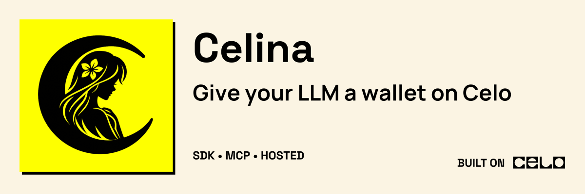

<p align="center">
  
</p>

# Celina

Open-source meta-repository for the [Celina](https://usecelina.xyz) agent stack on Celo mainnet — the SDK, the local MCP server, and the hosted MCP endpoint.

Listed in the [official Celo MCP docs](https://docs.celo.org/build-on-celo/build-with-ai/mcp/celina).

Hosted apps (website, Celeste, chat, API, bot, stats, and status) live in the private [`thecanvassing/celina-enterprise`](https://github.com/thecanvassing/celina-enterprise) meta-repo.

## Repositories

| Submodule | Link | Description |
|-----------|------|-------------|
| [celina-sdk](https://github.com/andrewkimjoseph/celina-sdk) | [usecelina.xyz/sdk](https://usecelina.xyz/sdk) | Shared TypeScript SDK and LLM tool catalog |
| [celina-mcp](https://github.com/andrewkimjoseph/celina-mcp) | [usecelina.xyz/mcp](https://usecelina.xyz/mcp) | MCP server for local stdio agents |
| [celina-mcp-remote](https://github.com/andrewkimjoseph/celina-mcp-remote) | [usecelina.xyz/mcp/remote](https://usecelina.xyz/mcp/remote) | Vercel-hosted read-only remote MCP endpoint |

Each submodule is an independent git repository with its own history, CI, and deploy targets. npm dependencies link packages (`celina-sdk` → `celina-mcp` → remote).

## Clone

```bash
git clone --recurse-submodules https://github.com/andrewkimjoseph/celina-oss.git
cd celina-oss
```

If you already cloned without submodules:

```bash
git submodule update --init --recursive
```

## Day-to-day workflow

| Task | Command |
|------|---------|
| Pull latest everywhere | `git pull && git submodule update --init --recursive` |
| Status across submodules | `./scripts/status-all.sh` |
| Work in one package | `cd celina-sdk` — commit and push in the submodule repo as usual |
| Bump submodule pointer | `./scripts/bump-submodule.sh celina-sdk` then `git push` |
| Workflow & releases (read first) | See [PUBLISH.md](PUBLISH.md) |

Agents: follow [AGENTS.md](AGENTS.md) in this repo.

After cloning, run `npm install` in each submodule you work in (`celina-sdk`, `celina-mcp`, `celina-mcp-remote`).
